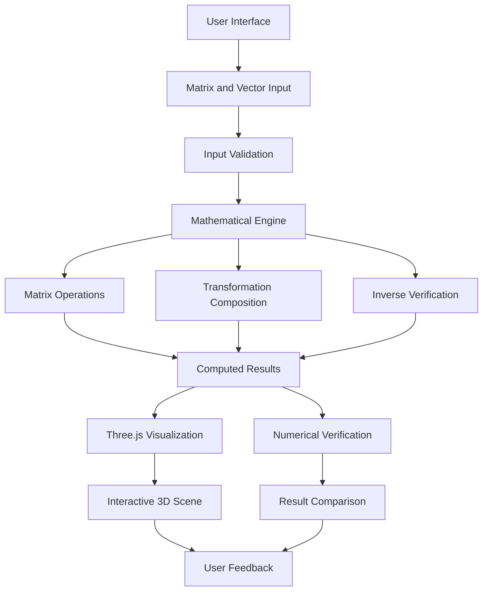
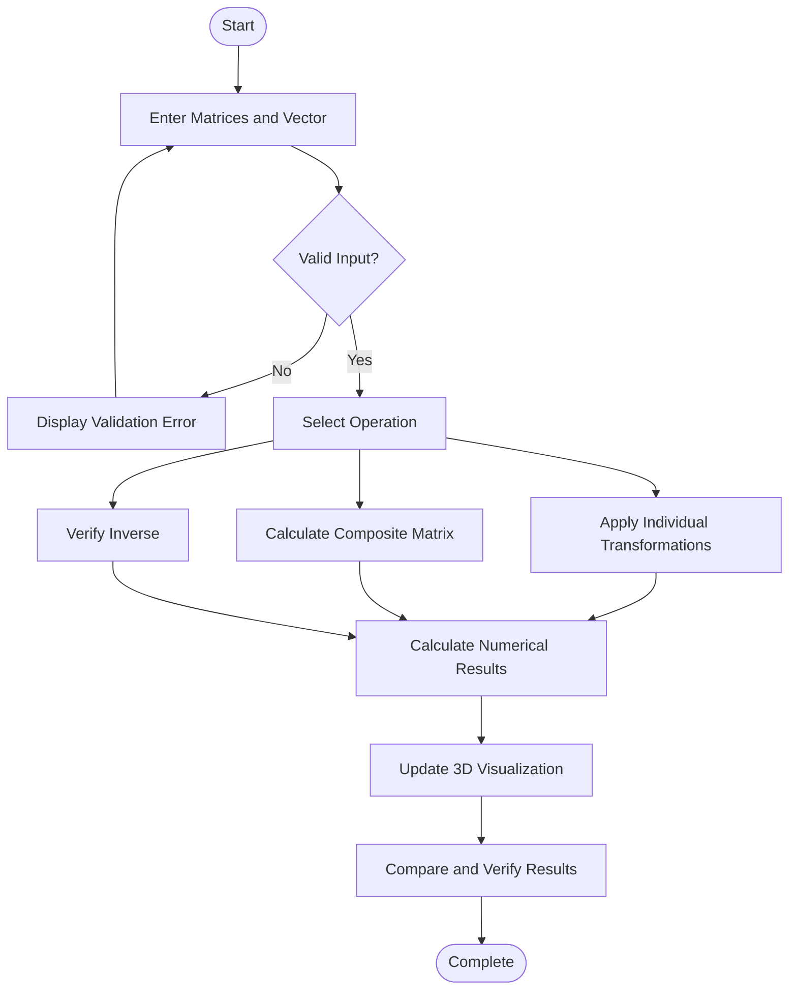

# Transformation Composition and Inverse Verification System

An interactive linear algebra visualization system for exploring **matrix transformations, transformation composition, inverse matrices, and their geometric effects in 3D space**.

The project connects mathematical theory with visual experimentation, allowing users to define transformations, apply them to vectors, observe the resulting geometric changes, and verify mathematical properties through computation.

## Overview

Linear algebra is fundamental to computer graphics, robotics, computer vision, and scientific computing. However, understanding how matrices transform vectors and how multiple transformations combine can be difficult when studying equations alone.

This project provides an interactive environment where users can experiment with transformation matrices and observe their effects visually.

The system focuses on three core areas:

- **Transformation Visualization:** Observe how matrices transform vectors and geometric objects.
- **Transformation Composition:** Combine multiple transformations and compare sequential application with the equivalent composite matrix.
- **Inverse Verification:** Verify whether an inverse transformation restores the original vector or geometric configuration.

The project is designed as a standalone application, with a focus on mathematical correctness, interactive visualization, and an intuitive user experience.

## Features

### 1. Matrix Input and Transformation Presets

- Manually enter \(3 \times 3\) transformation matrices.
- Define transformation matrices \(T_1\), \(T_2\), and optionally \(T_3\).
- Use predefined transformation presets:
  - Rotation
  - Scaling
  - Reflection
  - Shearing
- Enter custom vectors and observe their transformed positions.
- Validate matrix and vector inputs before computation.

### 2. Interactive 3D Visualization

- Visualize transformations in a 3D coordinate system.
- Observe the geometric effects of matrix operations.
- Compare original and transformed vectors or objects.
- Understand how individual transformations affect direction, magnitude, and orientation.

### 3. Transformation Composition

Combine two or more transformations into a single equivalent matrix.

For two transformations, the composite matrix is:

\[
T = T_2T_1
\]

For a column vector \(v\):

\[
v' = T_2(T_1v) = (T_2T_1)v
\]

The system helps users compare sequential transformation with direct application of the composite matrix.

> **Note:** Matrix multiplication is generally not commutative. In general, \(T_2T_1 \ne T_1T_2\).

### 4. Inverse Matrix Verification

- Calculate or verify the inverse of a transformation matrix.
- Apply a transformation followed by its inverse.
- Compare the recovered vector with the original vector.
- Verify the identity relationship:

\[
T^{-1}T = TT^{-1} = I
\]

A matrix has an inverse only when it is nonsingular. For a square matrix, this requires:

\[
\det(T) \ne 0
\]

The system should identify singular matrices and handle cases where an inverse does not exist.

### 5. Mathematical Verification

The system aims to make mathematical correctness observable rather than relying only on visual output.

- Compare sequential and composite transformations.
- Verify inverse transformation results.
- Detect invalid or singular matrices.
- Compare computed results using an appropriate numerical tolerance.
- Display numerical results alongside the visualization.

## Technology Stack

The following describes the intended framework and implementation architecture. The exact dependencies should match the versions and packages actually used in the repository.

| Component | Technology | Purpose |
|---|---|---|
| Frontend | JavaScript / HTML / CSS | User interface and interaction |
| Development framework | Vite | Development server and build tooling |
| Visualization | Three.js | Interactive 3D rendering |
| Mathematical engine | C++ | Matrix operations and transformation calculations |
| Web compilation | Emscripten / WebAssembly | Run compiled C++ calculations in the browser |
| Visualization foundation | `linmap3d` | Existing 3D linear transformation visualization foundation |
| Version control | Git and GitHub | Source control and collaboration |

### Framework Architecture



## System Workflow

The application follows a cycle of input, computation, visualization, and verification.



## Mathematical Foundation

### Matrix-vector multiplication

For a transformation matrix \(T\) and vector \(v\), the transformed vector is:

\[
v' = Tv
\]

For a \(3 \times 3\) matrix:

\[
T =
\begin{bmatrix}
a & b & c\\
d & e & f\\
g & h & i
\end{bmatrix}
\]

and a vector:

\[
v =
\begin{bmatrix}
x\\y\\z
\end{bmatrix}
\]

the transformed vector is:

\[
Tv =
\begin{bmatrix}
ax+by+cz\\
dx+ey+fz\\
gx+hy+iz
\end{bmatrix}
\]

### Transformation composition

For two transformations, the combined transformation is:

\[
T_{\text{combined}} = T_2T_1
\]

The rightmost matrix is applied first when column-vector notation is used.

### Inverse verification

If \(T\) is invertible, applying \(T\) followed by \(T^{-1}\) should recover the original vector:

\[
v_{\text{recovered}} = T^{-1}(Tv)
\]

Ideally:

\[
v_{\text{recovered}} = v
\]

In numerical computation, the result is checked within a suitable floating-point tolerance.

## Project Structure

The following is a suggested logical structure. Actual directories may differ depending on the current repository implementation.

```text
transformation-system/
├── src/
│   ├── components/
│   ├── visualization/
│   ├── mathematics/
│   ├── services/
│   └── main.js
├── public/
├── engine/
│   └── cpp/
├── tests/
├── index.html
├── package.json
├── vite.config.js
└── README.md
```

- `components/` — UI elements and input controls.
- `visualization/` — 3D scenes and rendering logic.
- `mathematics/` — Matrix and vector operations.
- `services/` — Communication between the interface and mathematical engine.
- `engine/cpp/` — C++ mathematical engine and WebAssembly integration, if implemented.
- `tests/` — Mathematical correctness and regression tests.

## Getting Started

### Prerequisites

Install the following tools according to the current implementation:

- Node.js and npm
- Git
- A modern web browser
- Emscripten SDK, if the mathematical engine is compiled from C++ to WebAssembly

### Installation

Clone the project repository:

```bash
git clone <YOUR_REPOSITORY_URL>
cd <YOUR_PROJECT_DIRECTORY>
```

Install the dependencies:

```bash
npm install
```

Start the development server:

```bash
npm run dev
```

Open the local URL displayed in the terminal.

### Production Build

```bash
npm run build
```

Preview the production build:

```bash
npm run preview
```

The available scripts depend on the project's `package.json`. If the C++ engine requires a separate compilation step, run the configured Emscripten build before building the frontend.

## Testing and Verification

Mathematical correctness is a core requirement of the project.

The following cases should be tested before introducing additional features:

- Identity transformation leaves vectors unchanged.
- Scaling changes vector magnitudes as expected.
- Rotation preserves lengths when using a proper rotation matrix.
- Sequential transformations match their composite matrix.
- Inverse transformations recover the original vector within numerical tolerance.
- Singular matrices are rejected for inverse calculations.
- Invalid matrix and vector inputs produce clear errors.
- Visualization updates correctly when inputs change.
- Existing features continue working after modifications.

## Development Roadmap

The project will prioritize completing and verifying existing functionality before expanding its mathematical capabilities.

- [ ] Complete matrix and vector input.
- [ ] Verify rotation, scaling, reflection, and shear presets.
- [ ] Complete and test transformation composition.
- [ ] Complete and test inverse verification.
- [ ] Validate edge cases and numerical accuracy.
- [ ] Verify synchronization between numerical results and 3D visualization.
- [ ] Improve usability and error handling.
- [ ] Add automated regression tests.
- [ ] Explore an Eigenvector Explorer after the existing system is stable.

## Design Principles

1. **Mathematical correctness:** Every displayed result should correspond to the underlying computation.
2. **Visual clarity:** Represent transformations in a way that supports understanding rather than distracting from it.
3. **Verification first:** Test existing functionality before introducing new modules.
4. **Modularity:** Keep the mathematical engine, interface, and visualization logically separated.
5. **Numerical reliability:** Account for floating-point precision and singular matrices.
6. **Interactive learning:** Allow users to change inputs and observe the consequences immediately.

## Future Scope

Potential extensions include:

- Eigenvalue and eigenvector visualization.
- Transformation decomposition.
- Basis-vector visualization.
- Step-by-step matrix multiplication.
- Numerical error analysis.
- Additional geometric objects and transformation comparisons.

These extensions can be introduced after the core composition, visualization, and inverse-verification features have been tested.

## Acknowledgements

The project builds upon the idea of interactive linear algebra visualization, using the existing `linmap3d` repository as its visualization foundation.

- Reference repository: [fatfreebutter/linmap3d](https://github.com/fatfreebutter/linmap3d)

## License

Add the project's chosen license here after confirming the licensing requirements of the original visualization repository and all dependencies.
